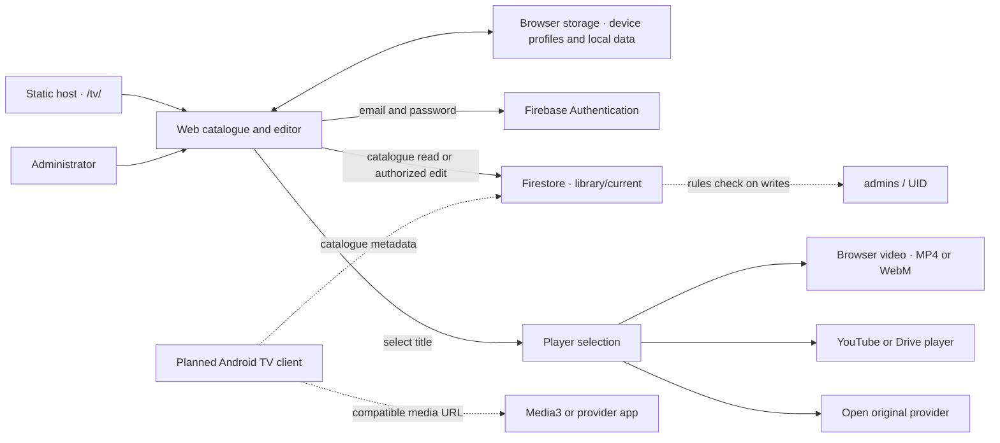
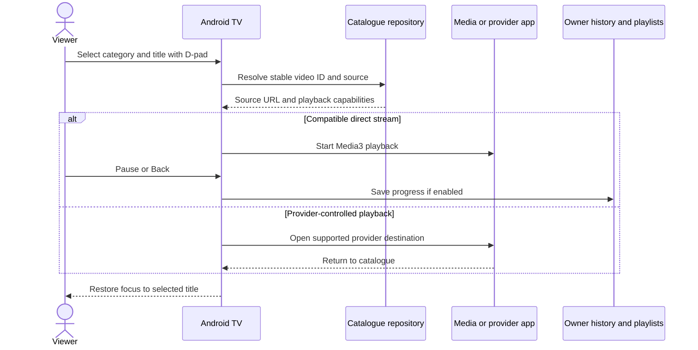

# Strand TV · Release and development guide

Launch a curated video library at **/tv/**. Put the catalogue and navigation on your domain. Let the original hosts serve the video. This keeps the first release small and lets the future Android TV client use the same editorial decisions.

## 1 · Choose the first release

| Capability | Web starter | Next milestone |
|---|---|---|
| Browse | Categories, TV-oriented focus navigation, playable sample catalogue | Test real remotes, TV screen sizes and Back behavior |
| Organize | Edit video links and categories locally, or configure a shared Firebase catalogue | Drafts, ordering, archive, editor audit trail |
| People | Manage device-local viewer profiles. With Firebase configured, email/password and a server-enforced admin allowlist protect shared edits | Manage authenticated users across devices from the dashboard |
| Watch | Native browser controls for compatible files, provider controls or handoff for hosted videos | Reliable resume for sources that expose progress |
| Personal library | Device storage provides a starting point for local preferences | Named playlists, local export/import, opt-in history, cross-device sync |
| Platform | Static web application deployable under a directory | Installable Android TV app and Play distribution |

**Two launch modes.** A static launch gives every visitor the bundled catalogue. Browser-local edits belong to that browser and can disappear when its site data is cleared. Use Firebase mode when an administrator needs an edit to reach other devices. Review every shared title and URL as public information. An access-controlled class library would require authenticated reads and provider-side access controls.

## 2 · Publish to the domain

The request mentions both `shakootattari.com` and `shakoorattari.com`. The examples below use the spelling from the IELTS URL. Verify the intended hostname and how the existing host routes requests before making a production change.

1. Unzip the release into an empty directory. Locate the directory containing `index.html`, `config.js`, scripts, styles and art. Those files form the entire static site. Keep their relative paths together.
2. For a quick local check, run `python3 -m http.server 8080` from that directory and open `http://localhost:8080/`. For a subpath check, put those files inside a folder named `tv`, run the server from its parent, and open `http://localhost:8080/tv/`.
3. **If the root domain is hosted by your own web server**, upload the files under the existing web root's `tv/` directory. The resulting path should be `tv/index.html`. Use the current HTTPS certificate. Ensure `/tv` redirects to `/tv/`. A root catch-all rewrite must let `/tv/` and its assets reach the static directory.
4. **If the domain is the custom domain of a GitHub Pages user or organization site**, create a project repository named `tv` under the same owner. Put the static files at the root of the publishing branch, then choose **Settings → Pages → Deploy from a branch → main → /(root)**. The project inherits the user site's domain at `/tv/`. Leave its project-level custom-domain field empty. A free GitHub account can publish from a public repository. [GitHub project domains](https://docs.github.com/en/pages/configuring-a-custom-domain-for-your-github-pages-site/about-custom-domains-and-github-pages)
5. **If your root server is elsewhere but you want GitHub Pages as origin**, publish the project at `https://OWNER.github.io/tv/`. Configure your existing server or edge router to proxy only `/tv/` and its descendants to that HTTPS origin with the origin host header. Preserve the path exactly once. Alternatively, keep the simpler static-folder setup from step 3. DNS selects a host, while HTTP routing selects a path.
6. Open `https://shakoorattari.com/tv/` in a fresh browser. Hard-refresh, play a compatible title, change categories, open the admin view, and revisit the root and `/ielts/`. Record the previous archive or Pages commit before release so rollback is a file restore or a commit revert. Restore catalogue data separately if it changed.

Do not enter a URL containing `/tv/` as a DNS record or GitHub custom domain. The app needs no domain transfer. Access to the repository or hosting control panel is the remaining dependency for publication on your domain.

## 3 · Connect a shared Firebase catalogue

1. Create a Firebase project on Spark, register a **Web app**, and copy its web configuration. Create the default Cloud Firestore database in **production mode**, choosing a region near your viewers.
2. Publish the supplied `firestore.rules` from **Firestore Database → Rules**. They represent the application's public catalogue boundary. If using an existing Firebase project, merge and test the app-specific matches against the project's other rules. Firestore grants access if any matching allow expression succeeds.
3. Enable **Authentication → Sign-in method → Email/Password**. In Authentication settings, add your final application hostname to authorized domains if needed. In **Users**, create the first administrator with a unique password and copy their exact Firebase UID.
4. In Firestore, create collection `admins` and a document whose ID equals that UID. An innocuous boolean field such as `enabled: true` can be used to create the record. The authorization check uses **document existence**. Remove the document to revoke the catalogue role. A console operator can manage the membership using trusted project permissions.
5. Set `window.STRAND_FIREBASE` in the release's `config.js` to the Web app configuration object from step 1. Publish that file with the app. Web config is designed for client use. Keep service-account keys and admin passwords out of the static site and repository.
6. Sign in as the administrator, save a catalogue edit, then reload in a separate signed-out browser. Verify the new title appears. Try a signed-out write and a signed-in non-admin write in the Firebase Rules simulator or emulator. Both must be denied. Verify a client cannot create its own admin record. Back up the initial shared catalogue before making bulk edits.

The Firebase console can create and remove Authentication identities. A future management UI should call a trusted backend using the Firebase Admin SDK for account creation, profile updates, disabling and deletion. That backend must authenticate the requester, verify their management role, protect the last administrator and record the operation. Removing a local viewer profile only affects this browser. [Firebase Admin user management](https://firebase.google.com/docs/auth/admin/manage-users) · [Firebase security rules](https://firebase.google.com/docs/rules/basics)

## 4 · How the pieces fit

This diagram shows the web release and the planned TV client. Both clients can read the same public metadata. Playback traffic goes directly to the selected source.

| Component | Technology and rationale |
|---|---|
| Static frontend | HTML, CSS and JavaScript. Relative assets allow a directory deployment, an ordinary static host or GitHub Pages. No build service is required to publish the compiled deliverable. |
| Remote-friendly navigation | Use focusable controls with visible focus, directional selection and a predictable return target. Retain a desktop-friendly editor so entering a long URL never requires a remote. |
| Catalogue store | A small library fits in one Firestore document. One read can retrieve the entire catalogue. Keep video bytes at their source. |
| Authentication and access | Firebase Authentication identifies an editor. Firestore Security Rules enforce write permissions independently of any client controls. |
| TV client | Kotlin and Compose for TV for focus and ten-foot layouts, Media3 ExoPlayer and MediaSession for supported streams and remote transport events. Use a provider-approved play path for external hosts. [Android TV setup](https://developer.android.com/training/tv/get-started/create) · [Media3 ExoPlayer](https://developer.android.com/media/media3/exoplayer) |

### Source-specific playback

| Source and expected input | What a viewer gets | Acceptance case |
|---|---|---|
| YouTube video link | Official embedded player with YouTube controls. Channel, private, restricted and embedding-disabled items need provider handling. | Try a known embeddable video and a video whose owner disabled embedding. Keep an original-link exit. [YouTube player parameters](https://developers.google.com/youtube/player_parameters) |
| HTTPS MP4 or WebM | Browser video controls. Seek depends on the host, media file and browser. Prefer sources with correct MIME type, byte-range support and a codec supported by the target TV. | Play, pause, seek forward/back, fullscreen where available, then close the player. Repeat with a missing file. |
| Google Drive file link | The Drive preview can play a supported, processed video that the viewer has permission to open. | Test in a clean signed-out session. A restricted file should request access or open in Drive. Check sharing first if a file works only for its owner. [Drive sharing](https://support.google.com/drive/answer/7166529) |
| OneDrive share link | Opens the original Microsoft-hosted page, which handles sign-in and playback. Later evaluate provider-generated embed links for supported account types. | Test a public link and a tenant-restricted link using the intended viewer account. [Microsoft video sharing](https://support.microsoft.com/en-us/clipchamp/stream-pages/share-a-video-or-audio-file-across-microsoft-365) |
| Other HTTPS web page | Opens the original website. A provider page may be a landing page, a login prompt or a player. | Verify the destination and the route back to the library on the target device. |

An embedded third-party player owns focus while the viewer is interacting inside it. Test how the specific TV browser exits that frame. A TV that lacks a suitable browser or a provider app may need the native client for a usable experience.

### Data ownership and cost

| Record | Owner and fields | Read/write behavior |
|---|---|---|
| `library/current` | Shared catalogue. Arrays `videos` and `categories` describe titles, source URLs, categories and display information. Keep private credentials and viewer data elsewhere. | Public catalogue read. Allowlisted editors save changes. |
| `admins/{uid}` | Project operator. The document ID matches an authenticated editor. | Managed from a trusted environment. Client-side account creation alone confers no editor access. |
| Device profiles and local state | Browser on the current origin. Directory paths under the same hostname share the origin, so use app-specific storage keys. | Local CRUD. Clearing site data or switching devices changes which profiles are available. |
| Future `users/{uid}/history/{videoId}` | Owner's playback position, duration, completion flag, update time. | Owner-only reads/writes. Checkpoint on pause, exit and coarse intervals. Provide a clear-history action. |
| Future `users/{uid}/playlists/{listId}` | Owner's title, revision, ordered video IDs or a paged items subcollection. | Keep a device copy in IndexedDB and sync after login. An offline playlist stores references. Streaming still requires the provider. |

The single-document limit is 1 MiB. Firestore's free allowance includes 1 GiB stored, 50,000 document reads/day, 20,000 writes/day, 20,000 deletes/day and 10 GiB outbound/month. At 2,000 catalogue loads/day with a 150 KiB document, the payload alone is about 8.6 GiB per 30 days. Retries, listeners and edit traffic add overhead. Track both transfer and operations. Split into `videos/{id}` and `categories/{id}` when size, query latency or overlapping edits warrant it. Introduce a versioned read model before changing saved data so older clients can continue to browse. [Firestore quotas](https://firebase.google.com/docs/firestore/quotas)

## 5 · Android TV and personal libraries

1. **Native viewing.** Build a landscape activity with the Leanback launcher category, TV banner and touchscreen declared optional. Map D-pad Center, media keys and Back. Keep the editor on the web. Test launcher visibility, focus after playback, reconnect, sleep/wake and a 720p device before an internal Play test. [Android TV project requirements](https://developer.android.com/training/tv/get-started/create)
2. **History and resume.** Use stable title IDs and owner-scoped storage. Start with direct media where the app can observe playback position. When a provider only receives an external handoff, record “opened” separately from “watched.” Add private viewing and a deletion control.
3. **Playlists.** First implement named, ordered device playlists with add/remove/reorder and JSON export/import. Validate imported URLs and handle retired video IDs. Then add signed-in sync with revision checks and a conflict-resolution prompt. Pick an explicit merge policy before enabling sync.
4. **Private Drive access.** Google sign-in establishes identity. Add a separate, explicit Drive consent step and a picker for files the user selects. Prefer the narrow `drive.file` scope where it fits. Store a private selection under its owner. A shared catalogue should only contain material the editor intends to share. Provide disconnect and handle expired access. [Drive authorization scopes](https://developers.google.com/workspace/drive/api/guides/api-specific-auth)
5. **Editorial improvements.** Add a broken-link report, optional captions for owned direct media, and an “unavailable” status so editors can retire a broken item while preserving saved references.

## 6 · Assignable work and release gates

Each row can be issued as a development ticket. Define source fixtures and stable IDs first so frontend, Android and data work can proceed independently.

| Owner | Deliverable and dependencies | Done when |
|---|---|---|
| Release / web | Deploy the archive to a staging `/tv/` prefix and document the actual domain route. Needs hosting access. | Fresh browser loads assets under the prefix, HTTPS and hard refresh work, root and IELTS still serve, and rollback restores the previous version. |
| Firebase / identity | Bootstrap production rules, editor UID and a staging catalogue. Propose a privileged account-management service with its hosting cost. | Two clients see a published edit. Guest and ordinary-user writes fail, promotion from the browser fails, and revoked editors lose write access. |
| Playback | Own the URL resolver and a fixture matrix, including private, broken, short-form and redirected links. Test provider behavior on desktop and TV. | Every accepted source resolves to one supported action with a return route. Playback failure leaves the library usable. |
| Android TV | Build the native browsing and viewing vertical slice against a staging catalogue. Depends on stable IDs and playback fixtures. | A tester can launch from the TV home screen, browse, play, pause and return to the same title using only the remote. |
| Personal library | Implement local playlists, then opt-in history and private sync. Depends on user identity for cross-device work. | Offline edits persist across restart. Two accounts cannot read one another's lists. Deleted titles and simultaneous edits have tested outcomes. |
| QA / release | Maintain signed-out, ordinary user and admin scenarios. Run at phone, desktop and TV sizes, with keyboard and a physical remote. | Record device/browser versions, a result per source, denied-access results, quota observations and the release hash. |

**Suggested sequence:** ship the static pilot, publish an editor-curated cloud catalogue, validate the native TV vertical slice, then build personal libraries. Prioritize real account administration ahead of personalization if people must log in to view protected content. Decide that audience boundary before placing private links in the catalogue.
