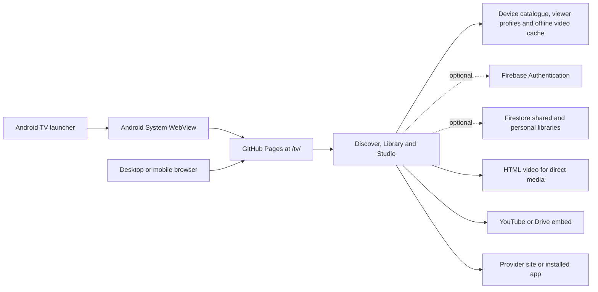

# Strand TV development guide

Start the static client with `python3 -m http.server 8080 --directory dist` from the repository root, then open http://localhost:8080/. Use a local test profile when exercising Studio writes. A fresh origin loads the bundled catalogue.

## Current architecture

| Code | Responsibility |
|---|---|
| `dist/app.js` | Hash navigation, category filters, directional focus, player selection, local catalogue migration and Studio editing. |
| `dist/kids-catalog.js` | Curated channel selections and playlist snapshot. Stable IDs and URL deduplication preserve existing device libraries when the seed is introduced. |
| `dist/video-editor.js` | YouTube URL preview, editable metadata lookup and cover selection. |
| `dist/firebase.js`, `firestore.rules` | Google and email/password sessions, personal and shared catalogue snapshots, transactional edits and owner-only personal library access. |
| `dist/offline.js`, `dist/sw.js` | Offline app startup, viewer-specific download lists, a device-wide media limit and byte-range playback. |
| `worker/` | Optional hosted metadata service. GitHub Pages serves static assets. The release guide describes metadata lookup on Pages. |
| `android/` | Java landscape Activity and TV launcher manifest, WebView configuration, fullscreen handling, external intents and Back behavior. |
| `.github/workflows/deploy.yml` | Client checks, Android build and lint, artifact staging, release signing and main-only publication. |

## Enable shared editing

1. Create a Firebase project on Spark, register a **Web app**, and copy its web configuration. Create the default Cloud Firestore database in **production mode**, choosing a region near your viewers.
2. Publish the supplied `firestore.rules` from **Firestore Database → Rules**. They represent the application's public catalogue boundary. If using an existing Firebase project, merge and test the app-specific matches against the project's other rules. Firestore grants access if any matching allow expression succeeds.
3. Enable **Authentication → Sign-in method → Email/Password**. In Authentication settings, add your final application hostname to authorized domains if needed. In **Users**, create the first administrator with a unique password and copy their exact Firebase UID.
4. In Firestore, create collection `admins` and a document whose ID equals that UID. An innocuous boolean field such as `enabled: true` can be used to create the record. The authorization check uses **document existence**. Remove the document to revoke the catalogue role. A console operator can manage the membership using trusted project permissions.
5. Set `window.STRAND_FIREBASE` in the release's `config.js` to the Web app configuration object from step 1. Publish that file with the app. Web config is designed for client use. Keep service-account keys and admin passwords out of the static site and repository.
6. Sign in as the administrator, save a catalogue edit, then reload in a separate signed-out browser. Verify the new title appears. Try a signed-out write and a signed-in non-admin write in the Firebase Rules simulator or emulator. Both must be denied. Verify a client cannot create its own admin record. Back up the initial shared catalogue before making bulk edits.

The Firebase console can create and remove Authentication identities. A future management UI should call a trusted backend using the Firebase Admin SDK for account creation, profile updates, disabling and deletion. That backend must authenticate the requester, verify their management role, protect the last administrator and record the operation. Removing a local viewer profile only affects this browser. [Firebase Admin user management](https://firebase.google.com/docs/auth/admin/manage-users) · [Firebase security rules](https://firebase.google.com/docs/rules/basics)

## Enable Google profiles and sync

Use the same Firebase project for web and Android. Complete the Firebase, authorized domain and Firestore rules setup above, then enable **Google** in Authentication → Sign-in method. Leave Email/Password enabled if Studio administrators use it. Open **Viewer profiles → Continue with Google** to sign in, then open **My library** from the same menu or from Studio. Add categories and videos in Studio. The same account sees those items on other devices. **Import device library** appears in personal Studio when there is a previously edited device catalogue. It merges videos and categories while keeping existing entries with the same ID or URL.

For GitHub Pages, set the repository Actions variable `STRAND_FIREBASE_CONFIG` to the Firebase Web app configuration as JSON. Set `STRAND_GOOGLE_CLIENT_ID` to the Google provider's Web client ID for native Android sign-in. For local or manually staged releases, set the corresponding values in `dist/config.js`. Register Android package `com.shakoorattari.strandtv` in the same Firebase project and add the published APK's signing certificate SHA-1. A preview build uses `com.shakoorattari.strandtv.preview` and needs its own registration and debug signing fingerprint. Use `apksigner verify --print-certs strand-tv.apk` to get the installed release's fingerprint. [Firebase web sign-in](https://firebase.google.com/docs/auth/web/google-signin) · [Android provider setup](https://firebase.google.com/docs/auth/android/google-signin)

Android TV sign-in uses Credential Manager on Android 14 or later with compatible Google Play services. The web app also supports Google sign-in in a regular browser with popups enabled. The initial sign-in and catalogue edits need internet access. A device with an existing session can read the last synced catalogue offline. [Android TV authentication requirements](https://developer.android.com/identity/form-factors#android-tv)

Before enabling the feature for viewers, use two browsers or a browser and an Android device. Sign in with the same Google account, add a title, and confirm the second device receives the change. Sign in with another user and check that their library is separate. Use the Firestore Rules simulator to verify a different UID and a signed-out client cannot read or write `users/{uid}/library/current`. Verify that a signed-in viewer cannot edit `library/current` without an admin record.

## Offline video

Open **Offline** to download a video, or change the device-wide limit (500 MB by default). The app also saves compatible videos as they play. You can turn automatic saving off in Offline settings. Set the limit to zero to clear downloads and stop future saves. The app removes the oldest saved videos first when it needs to make space. The limit covers downloaded video bytes. App files and browser-managed storage are separate, and a browser can clear its own site data. Open Strand TV online at least once to install its offline app files.

A downloadable source is a direct HTTPS MP4 or WebM URL that allows a CORS download from the app origin and returns a complete file with a video content type and a Content-Length header. YouTube, Drive previews, OneDrive shares and provider pages need an online connection for playback. Downloads and their limit stay on each device. An account syncs video links and categories. [YouTube developer policies](https://developers.google.com/youtube/terms/developer-policies#e-handling-youtube-data-and-content)

### Source-specific playback

| Source and expected input | What a viewer gets | Acceptance case |
|---|---|---|
| YouTube video link | Official embedded player with YouTube controls. Channel, private, restricted and embedding-disabled items need provider handling. | Try a known embeddable video and a video whose owner disabled embedding. Keep an original-link exit. [YouTube player parameters](https://developers.google.com/youtube/player_parameters) |
| HTTPS MP4 or WebM | Browser video controls. Seek depends on the host, media file and browser. Prefer sources with correct MIME type, byte-range support and a codec supported by the target TV. | Play, pause, seek forward/back, fullscreen where available, then close the player. Repeat with a missing file. |
| Google Drive file link | The Drive preview can play a supported, processed video that the viewer has permission to open. | Test in a clean signed-out session. A restricted file should request access or open in Drive. Check sharing first if a file works only for its owner. [Drive sharing](https://support.google.com/drive/answer/7166529) |
| OneDrive share link | Opens the original Microsoft-hosted page, which handles sign-in and playback. Later evaluate provider-generated embed links for supported account types. | Test a public link and a tenant-restricted link using the intended viewer account. [Microsoft video sharing](https://support.microsoft.com/en-us/clipchamp/stream-pages/share-a-video-or-audio-file-across-microsoft-365) |
| Other HTTPS web page | Opens the original website. A provider page may be a landing page, a login prompt or a player. | Verify the destination and the route back to the library on the target device. |

An embedded third-party player owns focus while the viewer is interacting inside it. Test how the specific TV browser exits that frame. A TV that lacks a suitable browser or a provider app may need the native client for a usable experience.

### Data ownership and cost

| Record | Owner and fields | Read/write behavior |
|---|---|---|
| `library/current` | Shared catalogue. Arrays `videos` and `categories` describe titles, source URLs, categories and display information. Keep private credentials and viewer data elsewhere. | Public catalogue read. Allowlisted editors save changes. |
| `admins/{uid}` | Project operator. The document ID matches an authenticated editor. | Managed from a trusted environment. Client-side account creation alone confers no editor access. |
| Device profiles and local state | Browser on the current origin. Directory paths under the same hostname share the origin, so use app-specific storage keys. | Local CRUD. Clearing site data or switching devices changes which profiles are available. |
| `users/{uid}/library/current` | Personal catalogue of video links and categories. | The owner can read and edit. The last downloaded catalogue is stored on the device for offline browsing. |
| Future `users/{uid}/history/{videoId}` | Owner's playback position, duration, completion flag, update time. | Owner-only reads/writes. Checkpoint on pause, exit and coarse intervals. Provide a clear-history action. |
| Future `users/{uid}/playlists/{listId}` | Owner's title, revision, ordered video IDs or a paged items subcollection. | Keep a device copy in IndexedDB and sync after login. An offline playlist stores references. Streaming still requires the provider. |

The single-document limit is 1 MiB. Firestore's free allowance includes 1 GiB stored, 50,000 document reads/day, 20,000 writes/day, 20,000 deletes/day and 10 GiB outbound/month. At 2,000 catalogue loads/day with a 150 KiB document, the payload alone is about 8.6 GiB per 30 days. Retries, listeners and edit traffic add overhead. Track both transfer and operations. Split into `videos/{id}` and `categories/{id}` when size, query latency or overlapping edits warrant it. Introduce a versioned read model before changing saved data so older clients can continue to browse. [Firestore quotas](https://firebase.google.com/docs/firestore/quotas)

## Verification beyond CI

CI checks web script syntax and builds and lints Android. Test Studio CRUD, a stale local catalogue, YouTube autofill, focus after closing a player, external handoff, interrupted network access and real-device APK installation separately. The [project memory](PROJECT-MEMORY.md) assigns the outstanding tests and future features; the [release guide](RELEASE.md) covers production configuration and recovery.
