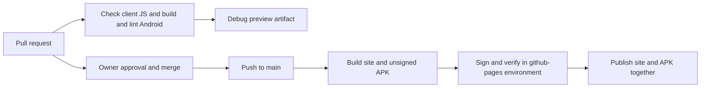

# Build, publish and recover Strand TV

The public GitHub repository is the source of truth. Production is the project site at **https://shakoorattari.com/tv/**. The Pages environment permits deployments from main. All paths in the web release must work under the /tv/ prefix. [Workflow](../.github/workflows/deploy.yml) · [Production APK](https://shakoorattari.com/tv/strand-tv.apk)



## Normal release

1. Open a feature branch and PR against main. CODEOWNERS assigns the entire repository to @shakoorattari. Protection applies to administrators and dismisses approvals after new commits. Keep the PR author separate from the approving owner. GitHub may also require a separate approval to start CI.
2. Review client syntax checks, Gradle debug and release builds and Android lint. A successful PR build uploads the preview APK under the artifact name `strand-tv-preview`. Its application ID ends in `.preview`. Use the production package for release upgrade testing.
3. After approval and merge, the push to main rebuilds, stages static assets and uploads the unsigned APK with the site as `release-inputs`. The deploy job signs the APK and runs `apksigner verify` before publishing the Pages artifact.
4. Open the production footer, follow the APK download, check the archive and verify its signer. Record the workflow run and test on a physical TV.

## Versions and changelog

The web app and the Android app have separate [semantic versions](https://semver.org/). Both live in [`dist/changelog.json`](../dist/changelog.json), newest release first. It is the only place to change them:

- The web app shows the file on its **About** page, and the first entry is the running web version. CI stamps it into `config.js` with the build commit.
- Gradle reads the first Android entry as `versionName`. `versionCode` is `100 + commits touching android/`, so it rises only when Android code changes. The offset keeps it above the run-number codes (up to 28) that earlier builds used. Keep it increasing.
- `version.json` publishes the Android version, its notes, the APK checksum and size. The app's update dialog shows those notes.
- After an update, each device shows **What's new** once, covering the releases since it last opened Strand TV.

Every pull request that changes `dist/` needs a new web entry. Every pull request that changes `android/` needs a new Android entry. Write changes for viewers, not developers. Use a patch version for fixes, a minor version for new features and a major version for breaking changes. CI runs `node scripts/check-changelog.mjs origin/main` and fails without the bump. Run it locally before pushing.

## Configuration

| Setting | Purpose |
|---|---|
| Environment secrets `TV_KEYSTORE`, `TV_KEY_PASSWORD` | Base64 PKCS#12 and its password. Alias `strandtv`. Used by the deploy job in the restricted `github-pages` environment. |
| Repository variable `STRAND_YOUTUBE_API_KEY` | Optional browser key for title and description lookup. Restrict to the YouTube Data API and intended HTTP referrers because it ships to the client. |
| Repository variable `STRAND_FIREBASE_CONFIG` | Public Firebase Web SDK configuration written into the site build. Firestore Security Rules enforce data access. |
| Repository variable `STRAND_GOOGLE_CLIENT_ID` | Public OAuth Web client ID compiled into the Android build as its fixed Google sign-in audience. OAuth client secrets stay out of these variables and the release. |
| Signing backup | The maintainer holds the original release identity in the checkout’s ignored `.android-signing/` directory. Keep a protected recoverable copy. Never commit the keystore, private key or password. |

The first verified release certificate has SHA-256 fingerprint `8F:08:46:FE:1A:68:9E:12:AC:AA:B1:B3:82:DA:83:69:13:02:15:A7:AD:14:2D:33:1A:DC:C3:A0:5C:67:73:E4`. Use Android SDK Build Tools to compare the public signer locally:

```sh
apksigner verify --verbose --print-certs strand-tv.apk
```

## When a release fails

- **Gradle fails before compilation with HTTP 429.** Identify the missing dependency and repository. Check that both repository blocks in `android/settings.gradle` retain Google’s Maven Central mirror. Retry transient fetch failures once the dependency endpoint responds.
- **Build succeeded, signing failed.** Inspect the first apksigner error and check the environment secret names. A missing or malformed keystore can fail during PKCS#12 parsing. Restore the original identity and password through the environment’s secret settings. Retry the failed deployment while its build artifact remains available.
- **Pages succeeded but the installer looks stale.** Verify the deployed commit, resolve the footer link on the production domain, download the APK and compare its signing certificate. An installed preview package uses a separate ID.
- **A published change needs rollback.** Revert the faulty change through a reviewed PR and publish from main again. Preserve the production signer and increasing version code for Android updates. Restore or migrate Firestore records separately if a data change was involved.
